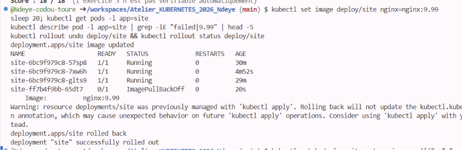
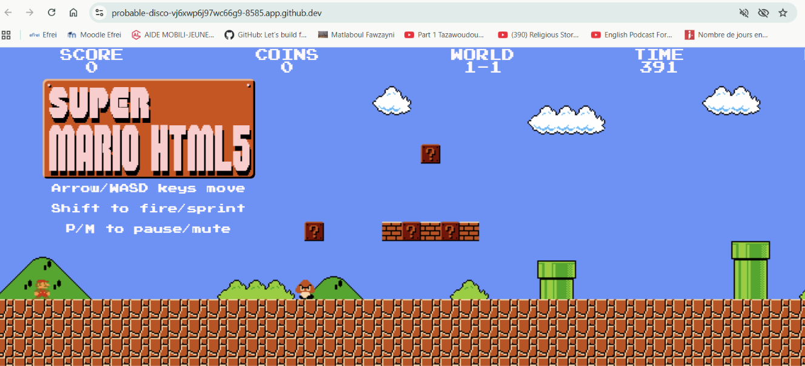
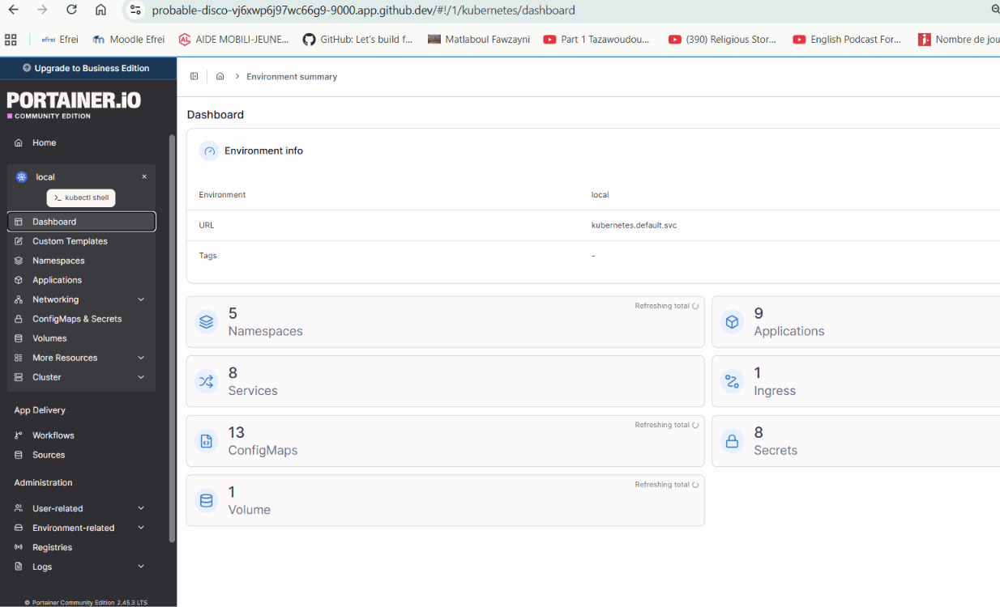
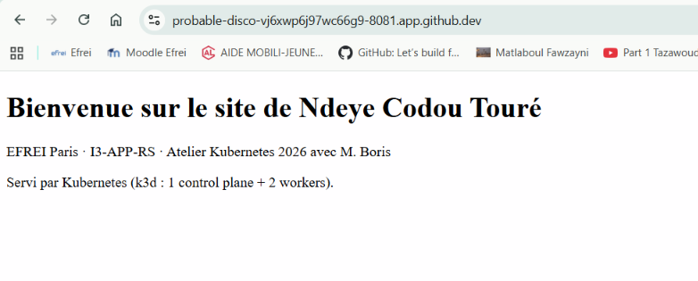
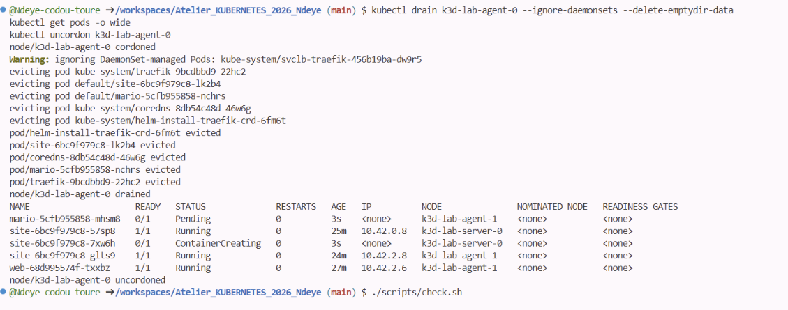
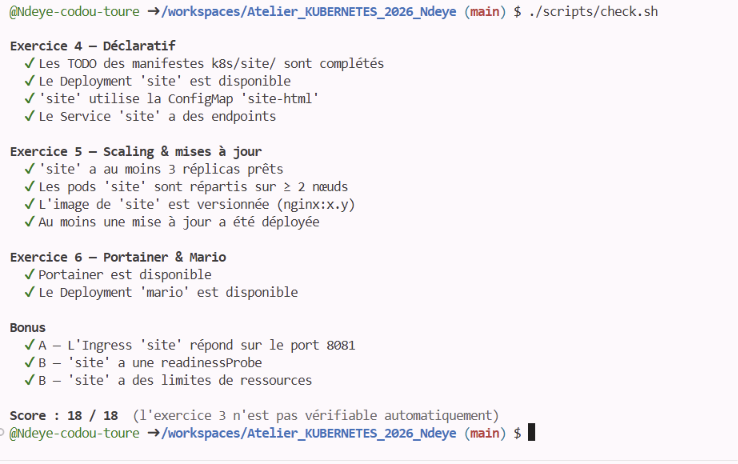

# Rendu — Atelier Kubernetes

> Complétez ce fichier au fil de l'atelier, puis faites un commit et un push (voir la section « Rendu » du README).

**Nom / Prénom :** TOURÉ Ndeye Codou
**Groupe :** I3-APP-RS

---

## Exercice 1 — Cluster

1. Combien de nœuds affiche `kubectl get nodes` ? Quel est le rôle de chacun ?
   > 3 nœuds, tous `Ready` (k3s v1.35.5) :
   > - `k3d-lab-server-0`, rôle `control-plane` : héberge le plan de contrôle (API Server, scheduler, controller-manager, base d'état). C'est lui qui décide où placer les pods.
   > - `k3d-lab-agent-0` et `k3d-lab-agent-1`, rôle `<none>` : ce sont les workers, qui exécutent les pods des applications.
   >
   > Même sur un cluster « vide », `kubectl get pods -A` montre des pods système dans le namespace `kube-system` : `coredns` (DNS interne), `local-path-provisioner` (stockage) et `metrics-server` (métriques). Quelques secondes plus tard apparaissent aussi `traefik` et `svclb-traefik` (Ingress Controller), installés par les jobs `helm-install-traefik*`.
2. Que montre `docker ps` ? Qu'est-ce qu'un « nœud » dans k3d, concrètement ?
   > `docker ps` montre 4 conteneurs : un par nœud (`k3d-lab-server-0`, `k3d-lab-agent-0`, `k3d-lab-agent-1`, image `rancher/k3s:v1.35.5-k3s1`) plus `k3d-lab-serverlb` (image `k3d-proxy`), le load balancer qui expose le cluster (port 8081 → 80). Concrètement, un « nœud » k3d est donc **un conteneur Docker qui exécute k3s** (une distribution Kubernetes légère), et non une vraie machine : les pods tournent à l'intérieur de ces conteneurs.

## Exercice 2 — Premier déploiement

3. Quels objets Kubernetes ont été créés par `kubectl create deployment` ? (indice : `kubectl get all`)
   > `kubectl create deployment web` crée un **Deployment** `web`, qui crée un **ReplicaSet** `web-xxxxx`, qui crée lui-même un **Pod** `web-xxxxx-yyyyy`. Le **Service** `web` (ClusterIP, port 80) vient de `kubectl expose`, pas de `create deployment`.
4. Vous avez supprimé le pod `web-...` : que s'est-il passé, et pourquoi ?
   > Dans `kubectl get pods -w`, l'ancien pod passe en `Terminating` et un nouveau pod, **avec un nom différent**, apparaît (`ContainerCreating` puis `Running`). Le ReplicaSet constate que l'état réel (0 pod) ne correspond plus à l'état désiré (1 replica) et recrée un pod : c'est la **boucle de réconciliation** de Kubernetes (auto-réparation).

## Exercice 3 — Modifier un conteneur en direct

5. Après suppression du pod, votre message « Bienvenue... » a-t-il survécu ? Pourquoi ?
   > Non. Le système de fichiers d'un conteneur est **éphémère** : le nouveau pod est recréé à partir de l'image `nginx` d'origine, et la modification faite avec `kubectl exec` dans l'ancien conteneur est perdue. Il faut décrire le contenu **en dehors** du conteneur (ConfigMap, volume, image).
6. Pourquoi le `port-forward` a-t-il cessé de fonctionner après la suppression du pod ?
   > `kubectl port-forward svc/web` ne passe pas réellement par le Service : il choisit **un seul pod** derrière le Service au démarrage et s'y attache. Quand ce pod est supprimé, le tunnel n'a plus de cible et s'arrête (l'erreur apparaît dans `/tmp/web.log`). Il faut relancer le tunnel vers le nouveau pod.

## Exercice 4 — Déclaratif

7. Quelle différence entre `kubectl create` et `kubectl apply` ?
   > `kubectl create` est **impératif** : il crée un objet et échoue s'il existe déjà (`AlreadyExists`). `kubectl apply -f` est **déclaratif** : il compare l'état décrit dans les fichiers YAML avec l'état du cluster, puis crée ou met à jour ce qui diffère. On peut le relancer autant de fois que nécessaire (idempotent), et les fichiers versionnés dans Git deviennent la référence.
8. À quoi sert le `selector` d'un Service ? Que se passe-t-il s'il ne correspond à aucun pod ?
   > Le `selector` indique au Service **quels pods** reçoivent le trafic, grâce à leurs labels (`app: site`). S'il ne correspond à aucun pod, le Service existe mais n'a **aucun endpoint** (`kubectl get endpoints site` est vide) : les requêtes n'aboutissent pas (connexion refusée ou timeout), sans erreur visible au niveau du Service lui-même.

## Exercice 5 — Scaling & mises à jour

9. Sur quels nœuds se trouvent vos 3 réplicas ? Collez la sortie de `kubectl get pods -l app=site -o wide`.
   ```
   NAME                    READY   STATUS              RESTARTS   AGE   IP          NODE               NOMINATED NODE   READINESS GATES
   site-5b4c8d6fd5-2tv2p   0/1     ContainerCreating   0          8s    <none>      k3d-lab-agent-1    <none>           <none>
   site-5b4c8d6fd5-fgxks   0/1     ContainerCreating   0          8s    <none>      k3d-lab-agent-0    <none>           <none>
   site-5b4c8d6fd5-g28n7   1/1     Running             0          86s   10.42.0.7   k3d-lab-server-0   <none>           <none>
   ```
   > Le scheduler a placé **un pod sur chacun des 3 nœuds** : `k3d-lab-server-0`, `k3d-lab-agent-0` et `k3d-lab-agent-1`. Dans k3s, le control plane accepte aussi des pods applicatifs. Répartir les réplicas évite de tout perdre si un nœud tombe.

10. Avec l'image `nginx:9.99`, quel statut avait le pod ? Quelle commande vous a donné la cause ?
    ```
    NAME                    READY   STATUS             RESTARTS   AGE
    site-6bc9f979c8-57sp8   1/1     Running            0          30m
    site-6bc9f979c8-7xw6h   1/1     Running            0          4m52s
    site-6bc9f979c8-glts9   1/1     Running            0          29m
    site-ff7b4f9bb-65dt7    0/1     ImagePullBackOff   0          20s
    ```
    > Le nouveau pod est en `ImagePullBackOff` (précédé de `ErrImagePull`) : Kubernetes n'arrive pas à télécharger l'image. `kubectl describe pod -l app=site` montre `Image: nginx:9.99` et, dans la section **Events**, l'échec du pull : ce tag n'existe pas sur Docker Hub. Correction : `kubectl rollout undo deploy/site`, puis `kubectl diff -f k8s/site/` ne renvoie plus aucune différence entre le cluster et les fichiers.
    >
    > 

11. Pendant la panne, le site restait-il accessible ? Pourquoi ?
    > Oui. Avec la stratégie **RollingUpdate**, Kubernetes ne supprime les anciens pods qu'une fois les nouveaux prêts. Le nouveau pod n'est jamais devenu `Ready`, donc les anciens pods `nginx:1.28` ont continué à tourner et à recevoir le trafic du Service. Le déploiement est resté bloqué, mais sans coupure de service : la sortie ci-dessus montre les 3 anciens pods toujours `1/1 Running` pendant que le nouveau pod est en échec.

## Exercice 6 — Portainer & Mario

12. URL publique de votre Mario :
    > https://probable-disco-vj6xwp6j97wc66g9-8585.app.github.dev/
    >
    > 
13. Retrouvez le Deployment `mario` en ligne de commande. Portainer et `kubectl` parlent-ils au même composant ? Lequel ?
    > Oui. `kubectl get deploy mario -o yaml` affiche un Deployment standard, comme ceux créés en ligne de commande ; seules quelques annotations ou labels ajoutés par Portainer diffèrent. Portainer et `kubectl` sont deux **clients** du même composant : l'**API Server** de Kubernetes (sur le control plane). Portainer y accède depuis l'intérieur du cluster via son ServiceAccount, `kubectl` depuis le Codespace via le kubeconfig. Le tableau de bord Portainer (environnement `local`, URL `kubernetes.default.svc`, c'est-à-dire l'API Server vu de l'intérieur du cluster) affiche les mêmes ressources que `kubectl` : 5 namespaces, 9 applications, 8 services, 1 Ingress.
    >
    > 

## Bonus (facultatif)

14. Bonus réalisés et remarques :
    > - **A — Ingress** : `k8s/bonus/ingress.yaml` envoie `/` vers le Service `site` (port 80) via Traefik, joignable sur le port 8081. Contrairement au `port-forward`, le site reste accessible quand on supprime des pods, car Traefik passe par le Service et ses endpoints. (Au premier `curl`, Traefik répondait `404 page not found` : la règle n'était pas encore prise en compte, quelques secondes ont suffi.)
    >
    >   
    > - **B — Probes et ressources** : `readinessProbe` HTTP sur `/` (port 80) et `resources` (requests 50m/32Mi, limits 100m/64Mi). Test réalisé avec une probe sur `/nope` (`kubectl patch`) : nginx répond 404, le nouveau pod reste `Running` mais `0/1` (jamais prêt, donc exclu des endpoints), tandis que les 3 anciens pods restent `1/1` : le rolling update se bloque sans coupure. Retour à la normale avec `kubectl rollout undo deploy/site`.
    >   ```
    >   site-569c969c54-bknwf   0/1     Running   0          21s
    >   site-6bc9f979c8-57sp8   1/1     Running   0          30m
    >   site-6bc9f979c8-7xw6h   1/1     Running   0          5m21s
    >   site-6bc9f979c8-glts9   1/1     Running   0          30m
    >   ```
    > - **C — Drain** : `kubectl drain k3d-lab-agent-0` a marqué le nœud `cordoned` puis évincé ses pods (`site`, `mario`, `traefik`, `coredns`) ; le DaemonSet `svclb-traefik` est ignoré. Les ReplicaSets les ont aussitôt recréés sur `k3d-lab-server-0` et `k3d-lab-agent-1`. Après `uncordon`, ils **ne reviennent pas** tout seuls : Kubernetes ne déplace pas des pods qui fonctionnent, seuls les nouveaux pods pourront de nouveau y être placés.
    >
    >   

---

**Score obtenu avec `./scripts/check.sh` :** 18 / 18


